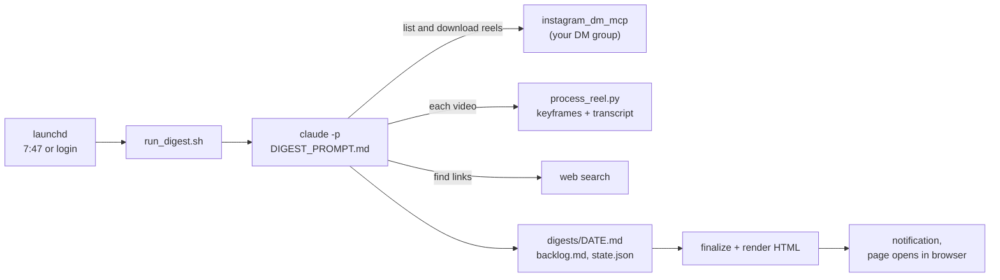

# Reel Digest

Turns the automation reels I send to an Instagram DM group into a morning digest of workflows I can build.

## The problem

I save automation and productivity reels by sending them to an Instagram group chat. Most never get watched again,
and the useful part (the exact prompt, the repo name, the order of steps) is buried in a 60-second video. Reel Digest
watches them every morning and writes down what each one shows, where to find the tools, and how to adapt it to my
own goals.

## Features

- **Reads one DM group.** You pick the group once. Each run scans its latest 100 messages for shared reels and posts
  it hasn't processed yet.
- **Watches each reel.** It downloads the video, transcribes it locally with faster-whisper, and pulls four keyframes
  so the agent can read on-screen text, URLs and UI screenshots. A vocabulary hint keeps tool names like "n8n" spelled
  right. Photo posts are read directly.
- **Finds the real links.** Repos, plugins, MCP servers and product pages come from the caption, the screen, the
  transcript, or one web search. It never invents a URL: a missing one is marked "link not found", and link
  shorteners are marked "unverified".
- **Writes a digest tailored to your goals**, which you describe in `context.md`:
  - a TL;DR;
  - flags for time-sensitive items, deadlines first;
  - today's build: one workflow, with steps concrete enough to follow without the reel;
  - for each reel: what it shows, the author's steps, your adapted steps, effort and value, and a verdict
    (Build, Act, Backlog or Skip);
  - the top 5 from a running backlog (`backlog.md`). Tick an item `[x]` and it is never suggested again.
- **Delivers it.** It renders a standalone HTML page (light and dark mode, click-to-zoom images), shows a macOS
  notification and opens the page in your browser.
- **Runs unattended.** It runs at 7:47 every morning, catches up after sleep or a shutdown, waits for the network,
  runs once a day, and stops after 60 minutes.
- **Remembers progress.** `state.json` records every processed reel, so each one is handled once. A run takes at most
  12 reels; the rest wait for the next morning.
- **Cleans up.** It keeps only the images the digest embeds and deletes videos and transcripts after a good run.
  Downloads from a failed run stay for 3 days, so a retry can reuse their transcripts.

See [examples/sample-digest.md](examples/sample-digest.md) for a short, fictional digest.

## How it works



1. **`run_digest.sh` starts**, from launchd or by hand. It skips the run if today's digest already exists, checks
   that the Instagram session and `config.json` are in place, and waits up to 2 minutes for instagram.com to respond.
2. **It runs Claude Code headless** (`claude -p`) with `DIGEST_PROMPT.md`, filling in today's date and the folder
   path. The run is locked down:
   - only the Instagram MCP server from `.mcp.json` is loaded (`--strict-mcp-config`);
   - the only Instagram tools allowed are `list_messages_compact` and `download_shared_post_from_message`. The send,
     like, delete, mute and mark-seen tools are denied;
   - edits are limited to `digests/`, `state.json` and `backlog.md`, and the only shell command allowed is
     `tools/process_reel.py`;
   - the prompt tells the agent that captions, transcripts and web pages are data written by strangers, never
     instructions.
3. **The agent picks reels.** It lists the group's latest messages and takes reels whose shortcode isn't in
   `state.json`: new ones oldest first, then older leftovers newest first. Text messages next to a reel are read as
   notes on why it was saved. For each reel it:
   - downloads the media into `media/<date>/`;
   - runs `tools/process_reel.py`, which gets the duration with ffprobe, extracts 4 evenly spaced keyframes (480 px
     wide) with ffmpeg, and transcribes the audio with the faster-whisper `small` model on the CPU (int8, with voice
     activity detection). Results are cached next to the video;
   - reads 2 to 4 keyframes and looks up the links.
4. **It writes the digest** to `digests/<date>.md`, updates `backlog.md` and `state.json`, and ends with one line:
   `OK: <n> new reels · <f> flags · today's build: <name>` or `ERROR: <reason>`.
5. **`run_digest.sh` finishes the job.** On `OK`, `finalize_digest.sh` copies the embedded images into
   `digests/img/<date>/` and deletes that day's downloads. `tools/render_digest.py` renders the HTML page; raw HTML
   in the Markdown is escaped, because captions are written by strangers. `digests/latest.html` is pointed at the new
   page and a notification appears. On `ERROR` or a timeout, the notification gives the reason. If the Instagram
   session has expired, the digest says so and tells you to run `./login_once.py`.

## Tech stack

- **Claude Code CLI**, run headless (`claude -p`) as the agent, with tool allow and deny lists
- **MCP:** [instagram_dm_mcp](https://github.com/trypeggy/instagram_dm_mcp), built on
  [instagrapi](https://github.com/subzeroid/instagrapi)
- **Python 3.11 or 3.12** with **uv**: faster-whisper for local speech-to-text, markdown-it-py for the HTML page
- **ffmpeg and ffprobe** for keyframes and video duration
- **zsh, launchd and osascript** on macOS for scheduling and notifications

## Getting started

### Prerequisites

- macOS. The scripts use launchd, `osascript`, `open` and BSD `sed`. I built and run it on an Intel Mac.
- [Claude Code](https://github.com/anthropics/claude-code), installed and logged in, with `claude` on your PATH.
  Each run uses your Claude Code plan or API key.
- [uv](https://docs.astral.sh/uv/), plus `ffmpeg` and `ffprobe` on your PATH.
- An Instagram account that is a member of the group you send reels to. A secondary account is safer; see
  [Status and limitations](#status-and-limitations).

### 1. Clone this repo and the Instagram MCP server

The Instagram MCP server is a separate project. Clone it into `instagram_dm_mcp/` inside this folder. That path is
gitignored, and the scripts expect the server there.

```sh
git clone <this repo's URL> reel-digest
cd reel-digest
git clone https://github.com/trypeggy/instagram_dm_mcp.git instagram_dm_mcp
```

**The upstream server needs changes before the digest works.** I built this against upstream commit `7c2b8c5` plus
local changes that are not part of this repo. Check upstream first, since some of these may have been fixed since:

- **Upgrade `instagrapi`** from 2.1.5 to 3.0.26 or newer. Instagram rejects the app version that 2.1.5 imitates
  ("Your version of Instagram is out of date").
- **Add a `list_messages_compact(thread_id, amount, since_timestamp)` tool.** It returns each message's ID,
  timestamp, sender ("me" for your own messages), text, link, and a `shared_post` object with `code`, `url`,
  `caption`, `author` and `video_duration`. The prompt and the tool allowlist in `run_digest.sh` use this name.
- **Read shared reels correctly.** instagrapi parses `clip` and `media_share` into model objects (the upstream code
  called `.get()` on them and crashed), and newer reel shares arrive as `xma_share`.
- **Return `caption`, `author` and `video_duration`** from `download_shared_post_from_message`.
- **Reuse the saved session without calling `login()`**, and load it with `override_app_version=True`. Raise an error
  instead of prompting when Instagram asks for verification, because a prompt would hang the stdio server. Wait 1 to
  3 seconds between API calls (`client.delay_range = [1, 3]`).

### 2. Add credentials and install the Python tools

```sh
cp .env.example instagram_dm_mcp/.env && chmod 600 instagram_dm_mcp/.env   # then fill it in
uv sync --project tools                                                    # faster-whisper, markdown-it-py
```

To run the tests (they mock ffmpeg and Whisper, so they need neither): `uv run --project tools pytest tools/tests`

The project reads these environment variables from `instagram_dm_mcp/.env`:

| Variable | What it is for |
|---|---|
| `INSTAGRAM_USERNAME` | The Instagram account in the group. It also names the session file. |
| `INSTAGRAM_PASSWORD` | The MCP server refuses to start without it. `login_once.py --password` logs in with it. |

Claude Code uses its own login, so the project reads no API keys. The first transcription downloads the Whisper
`small` model.

### 3. Log in and pick the group

```sh
./login_once.py
```

Run it from the project folder. Instagram currently rejects password logins from scripts (instagrapi issues
[#2807](https://github.com/subzeroid/instagrapi/issues/2807) and
[#2881](https://github.com/subzeroid/instagrapi/issues/2881)), so by default the script walks you through copying the
`sessionid` cookie from an Incognito browser login. It saves the session to
`instagram_dm_mcp/<username>_session.json` (chmod 600), lists your 40 most recent DM threads with groups first, and
writes the chosen group's ID and title to `config.json`. `./login_once.py --password` tries a password login instead.

### 4. Describe your goals

```sh
cp context.example.md context.md
```

Edit `context.md`. Give each goal a short bold label, and mark time-sensitive goals "(always flag)". The digest
tailors every plan to this file.

### 5. Point the MCP config at this folder and run once

```sh
sed -i '' "s|/path/to/reel-digest|$PWD|" .mcp.json
./run_digest.sh
```

This writes your local path into `.mcp.json`, which is tracked, so don't commit that change. The first run handles up
to 12 reels from the group's latest 100 messages.

### 6. Run it every morning at 7:47

`com.reeldigest.morning.plist` is a launchd template. It runs the digest at 7:47 every day and at every login. If the
Mac is asleep at 7:47, launchd runs it on wake. The login run covers a Mac that was shut down. Extra runs do nothing,
because `run_digest.sh` skips a day that already has a digest.

```sh
mkdir -p logs
sed "s|/path/to/reel-digest|$PWD|g" com.reeldigest.morning.plist > ~/Library/LaunchAgents/com.reeldigest.morning.plist
launchctl bootstrap gui/$(id -u) ~/Library/LaunchAgents/com.reeldigest.morning.plist
```

To change the time, edit `Hour` and `Minute` in the installed plist, then run `bootout` and `bootstrap` again. To
stop it, run `launchctl bootout gui/$(id -u)/com.reeldigest.morning`.

### Day to day

| To | Do |
|---|---|
| Retry after a failed run | `./run_digest.sh --force` |
| Fix "Instagram session needs a refresh" | `./login_once.py` |
| Watch a different group | `./login_once.py`, then answer `y` to "Change it?" |
| Get the notification without the browser tab | Add `"open_report": false` to `config.json` |
| Ask questions about the group | Open Claude Code in this folder. It loads the Instagram server from `.mcp.json`, with all of its tools, including send. |

## Project structure

```
reel-digest/
├── run_digest.sh                 entry point: checks setup, runs Claude Code headless, finalizes, notifies
├── DIGEST_PROMPT.md              the agent's instructions: which reels to take, how to find links, digest format
├── finalize_digest.sh            keeps the images a digest embeds, deletes that day's downloads
├── login_once.py                 Instagram session login and group picker (writes config.json)
├── tools/
│   ├── process_reel.py           video → keyframes (ffmpeg) and transcript (faster-whisper)
│   ├── render_digest.py          digest Markdown → standalone HTML page
│   ├── tests/                    pytest tests for both tools (ffmpeg and Whisper are mocked)
│   ├── pyproject.toml
│   └── uv.lock
├── context.example.md            template for context.md (your goals)
├── examples/sample-digest.md     a short, fictional digest
├── com.reeldigest.morning.plist  launchd template: 7:47 daily and at login
├── .mcp.json                     Claude Code MCP config for the Instagram server (template path)
├── .env.example                  Instagram credentials, copied to instagram_dm_mcp/.env
└── LICENSE                       MIT
```

These are created locally and gitignored: `instagram_dm_mcp/` (the cloned server, its `.env` and the session file),
`config.json`, `context.md`, `state.json`, `backlog.md`, `media/`, `digests/` and `logs/`.

## Status and limitations

- This is a personal tool that I run every morning on my own Mac. It only runs on macOS, it isn't packaged for other
  people. Tests cover `tools/` only; the shell scripts and the agent run are tested by hand.
- **It uses an unofficial Instagram API.** The MCP server is built on instagrapi, which imitates the Instagram mobile
  app to call Instagram's private API. It can break whenever Instagram changes something, and automated access like
  this can conflict with Instagram's Terms of Use. Instagram may challenge, rate-limit or lock the account. It is meant
  for your own account only, reading a group you are a member of. Keep it to one run a day.
- Sessions expire. When one does, you copy a fresh `sessionid` by hand; the unattended run can't log in.
- It depends on a patched third-party MCP server (see [step 1](#1-clone-this-repo-and-the-instagram-mcp-server)).
  Without those changes, the digest won't run.
- Reels are written by strangers, so prompt injection is a real risk. The prompt says to treat them as data, and the
  tool lists block sending, limit writes to three paths and allow one shell command. The agent can still search and
  fetch web pages, so this reduces the risk but doesn't remove it.
- It only sees the group's latest 100 messages, and only 4 keyframes per video, so on-screen text shown between
  keyframes can be missed.
- Runs are slow and use Claude Code usage: up to 12 reels, local transcription on the CPU, and a 60-minute limit.

## License

[MIT](LICENSE)
