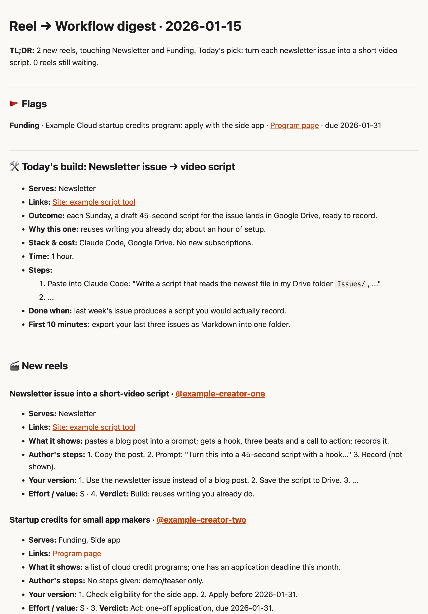
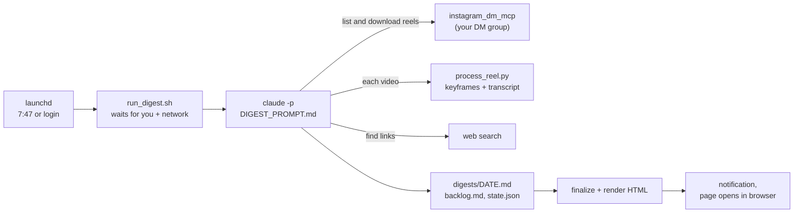

# Reel Digest: turn saved Instagram reels into step-by-step workflows with Claude Code

[](LICENSE)


**An AI agent that watches the Instagram reels you save and writes a morning digest of workflows you can actually build.** Send automation and productivity reels to an Instagram group chat. Every morning, Reel Digest runs Claude Code headless with an Instagram MCP server, downloads each new reel, transcribes it locally with Whisper, reads its keyframes, finds the real links (repos, plugins, MCP servers, product pages), and writes a step-by-step digest tailored to your own goals. It runs unattended on your Mac. Transcription is local; the only service that sees a reel's content is Claude Code, the agent you already use.

- **Saved reels you never rewatch?** Each one becomes a written summary with the exact prompt, tool names, settings and order of steps.
- **"Link in bio" hunting?** It finds the repo, plugin or product page from the caption, the screen, the transcript or one web search, and never invents a URL.
- **Too many ideas, no plan?** One "today's build" per morning, picked against your goals, with steps concrete enough to follow without the reel.
- **Deadlines buried in videos?** Time-sensitive items (grants, credits, launches) are flagged first.

<p align="center">
  <picture>
    <source media="(prefers-color-scheme: dark)" srcset="docs/digest-dark.png">
    
  </picture>
  <br><sub>A digest page, rendered from the fictional <a href="examples/sample-digest.md">sample digest</a>.</sub>
</p>

## Contents

· [Features](#features) 
· [How it works](#how-it-works) 
· [Getting started](#getting-started) 
· [Day to day](#day-to-day) 
· [FAQ](#faq) 
· [Project structure](#project-structure) 
· [Status and limitations](#status-and-limitations) 
· [Contributing](#contributing) 
· [License](#license)

## Features

- **Reads one DM group.** You pick the group once. Each run scans its latest 100 messages for shared reels and posts
  it hasn't processed yet.
- **Watches each reel.** It downloads the video, transcribes it locally with faster-whisper, and pulls four keyframes
  so the agent can read on-screen text, URLs and UI screenshots. A vocabulary hint keeps tool names like "n8n" spelled
  right. Photo posts are read directly.
- **Finds the real links.** Repos, plugins, MCP servers and product pages come from the caption, the screen, the
  transcript, or one web search. It never invents a URL: a missing one is marked "link not found", and link
  shorteners are marked "unverified".
- **Writes a digest tailored to your goals**, which you describe in `context.md`:
  - a TL;DR;
  - flags for time-sensitive items, deadlines first;
  - today's build: one workflow, with steps concrete enough to follow without the reel;
  - for each reel: what it shows, the author's steps, your adapted steps, effort and value, and a verdict
    (Build, Act, Backlog or Skip);
  - the top 5 from a running backlog (`backlog.md`). Tick an item `[x]` and it is never suggested again.
- **Delivers it.** It renders a standalone HTML page (light and dark mode, click-to-zoom images), shows a macOS
  notification and opens the page in your browser.
- **Runs unattended.** It runs at 7:47 every morning, catches up after sleep or a shutdown, waits for the network,
  runs once a day, and stops after 60 minutes.
- **Copes with a laptop's day.** It doesn't start during a lid-closed "dark wake" (it waits until someone is at the
  Mac), keeps the Mac from idle-sleeping mid-run, and if a run fails, retries once when the Mac is in use again. A
  failed run never blocks the next one.
- **Remembers progress.** `state.json` records every processed reel, so each one is handled once. A run takes at most
  12 reels; the rest wait for the next morning.
- **Cleans up.** It keeps only the images the digest embeds and deletes videos and transcripts after a good run.
  Downloads from a failed run stay for 3 days, so a retry can reuse their transcripts.
- **Locked down.** The agent can read the group and download reels, but every send, like, delete, mute and mark-seen
  tool is denied, file edits are limited to three paths, and only one shell command is allowed.

## How it works



1. **`run_digest.sh` starts**, from launchd or by hand. It skips the run if today's digest already exists, checks
   that the Instagram session and `config.json` are in place, waits until someone is at the Mac (screen on and
   keyboard or trackpad used in the last 10 minutes; a run you start by hand passes at once), and waits up to
   2 minutes for instagram.com to respond.
2. **It runs Claude Code headless** (`claude -p`) with `DIGEST_PROMPT.md`, filling in today's date and the folder
   path, under `caffeinate` so the Mac doesn't idle-sleep. The run is locked down:
   - only the Instagram MCP server from `.mcp.json` is loaded (`--strict-mcp-config`);
   - the only Instagram tools allowed are `list_messages_compact` and `download_shared_post_from_message`. The send,
     like, delete, mute and mark-seen tools are denied;
   - edits are limited to `digests/`, `state.json` and `backlog.md`, and the only shell command allowed is
     `tools/process_reel.py`;
   - the prompt tells the agent that captions, transcripts and web pages are data written by strangers, never
     instructions.
3. **The agent picks reels.** It lists the group's latest messages and takes reels whose shortcode isn't in
   `state.json`: new ones oldest first, then older leftovers newest first. Text messages next to a reel are read as
   notes on why it was saved. For each reel it:
   - downloads the media into `media/<date>/`;
   - runs `tools/process_reel.py`, which gets the duration with ffprobe, extracts 4 evenly spaced keyframes (480 px
     wide) with ffmpeg, and transcribes the audio with the faster-whisper `small` model on the CPU (int8, with voice
     activity detection). Results are cached next to the video;
   - reads 2 to 4 keyframes and looks up the links.
4. **It writes the digest** to `digests/<date>.md`, updates `backlog.md` and `state.json`, and ends with one line:
   `OK: <n> new reels · <f> flags · today's build: <name>` or `ERROR: <reason>`.
5. **`run_digest.sh` finishes the job.** On `OK`, `finalize_digest.sh` copies the embedded images into
   `digests/img/<date>/` and deletes that day's downloads. `tools/render_digest.py` renders the HTML page; raw HTML
   in the Markdown is escaped, because captions are written by strangers. `digests/latest.html` is pointed at the new
   page and a notification appears. On `ERROR` or a timeout, it waits until the Mac is in use again and retries once
   (not for an expired session); if that fails too, the notification gives the reason and the failed digest is moved
   to `logs/` so the next login tries again. If the Instagram session has expired, the digest says so and tells you
   to run `./login_once.py`.

### Tech stack

- **Claude Code CLI**, run headless (`claude -p`) as the agent, with tool allow and deny lists
- **MCP:** [instagram_dm_mcp](https://github.com/hanshika0292/instagram_dm_mcp) (my fork of trypeggy's server), built on
  [instagrapi](https://github.com/subzeroid/instagrapi)
- **Python 3.11 or 3.12** with **uv**: faster-whisper for local speech-to-text, markdown-it-py for the HTML page
- **ffmpeg and ffprobe** for keyframes and video duration
- **zsh, launchd, caffeinate and osascript** on macOS for scheduling, keeping awake and notifications

## Getting started

### Prerequisites

- macOS on Apple silicon or Intel. The scripts use launchd, `osascript`, `caffeinate`, `pmset`, `open` and BSD
  `sed`. It runs every morning on an M5 Pro MacBook Pro.
- [Claude Code](https://github.com/anthropics/claude-code), installed and logged in, with `claude` on your PATH.
  Each run uses your Claude Code plan or API key.
- [uv](https://docs.astral.sh/uv/), plus `ffmpeg` and `ffprobe` on your PATH (`brew install uv ffmpeg`).
- An Instagram account that is a member of the group you send reels to. A secondary account is safer; see
  [Status and limitations](#status-and-limitations).

### 1. Clone this repo and the Instagram MCP server

The Instagram MCP server is a separate project. Clone
[my fork of it](https://github.com/hanshika0292/instagram_dm_mcp) into `instagram_dm_mcp/` inside this folder. That
path is gitignored, and the scripts expect the server there.

```sh
git clone https://github.com/hanshika0292/reel-digest.git
cd reel-digest
git clone https://github.com/hanshika0292/instagram_dm_mcp.git instagram_dm_mcp
uv sync --project instagram_dm_mcp
```

Use the fork, not [upstream](https://github.com/trypeggy/instagram_dm_mcp). Upstream's pinned instagrapi is rejected
by Instagram, it crashes on shared reels, and it lacks the `list_messages_compact` tool the digest uses. The fork
fixes these; the fixes are also open as upstream PRs
[#14](https://github.com/trypeggy/instagram_dm_mcp/pull/14)–[#17](https://github.com/trypeggy/instagram_dm_mcp/pull/17).

### 2. Add credentials and install the Python tools

```sh
cp .env.example instagram_dm_mcp/.env && chmod 600 instagram_dm_mcp/.env   # then fill it in
uv sync --project tools                                                    # faster-whisper, markdown-it-py
```

To run the tests (they mock ffmpeg and Whisper, so they need neither): `uv run --project tools pytest tools/tests`

The project reads these environment variables from `instagram_dm_mcp/.env`:

| Variable | What it is for |
|---|---|
| `INSTAGRAM_USERNAME` | The Instagram account in the group. It also names the session file. |
| `INSTAGRAM_PASSWORD` | The MCP server refuses to start without it. `login_once.py --password` logs in with it. |

Claude Code uses its own login, so the project reads no API keys. The first transcription downloads the Whisper
`small` model.

### 3. Log in and pick the group

```sh
./login_once.py
```

Run it from the project folder. Instagram currently rejects password logins from scripts (instagrapi issues
[#2807](https://github.com/subzeroid/instagrapi/issues/2807) and
[#2881](https://github.com/subzeroid/instagrapi/issues/2881)), so by default the script walks you through copying the
`sessionid` cookie from an Incognito browser login. It saves the session to
`instagram_dm_mcp/<username>_session.json` (chmod 600), lists your 40 most recent DM threads with groups first, and
writes the chosen group's ID and title to `config.json`. `./login_once.py --password` tries a password login instead.

### 4. Describe your goals

```sh
cp context.example.md context.md
```

Edit `context.md`. Give each goal a short bold label, and mark time-sensitive goals "(always flag)". The digest
tailors every plan to this file.

### 5. Point the MCP config at this folder and run once

```sh
sed -i '' "s|/path/to/reel-digest|$PWD|" .mcp.json
./run_digest.sh
```

This writes your local path into `.mcp.json`, which is tracked, so don't commit that change. The first run handles up
to 12 reels from the group's latest 100 messages.

### 6. Run it every morning at 7:47

`com.reeldigest.morning.plist` is a launchd template. It runs the digest at 7:47 every day and at every login. If the
Mac is asleep at 7:47, launchd runs it on wake, and the script waits until you're actually using the Mac. The login
run covers a Mac that was shut down. Extra runs do nothing, because `run_digest.sh` skips a day that already has a
digest.

```sh
mkdir -p logs
sed "s|/path/to/reel-digest|$PWD|g" com.reeldigest.morning.plist > ~/Library/LaunchAgents/com.reeldigest.morning.plist
launchctl bootstrap gui/$(id -u) ~/Library/LaunchAgents/com.reeldigest.morning.plist
```

To change the time, edit `Hour` and `Minute` in the installed plist, then run `bootout` and `bootstrap` again. To
stop it, run `launchctl bootout gui/$(id -u)/com.reeldigest.morning`.

## Day to day

| To | Do |
|---|---|
| Retry after a failed run | `./run_digest.sh --force` |
| Fix "Instagram session needs a refresh" | `./login_once.py` |
| Watch a different group | `./login_once.py`, then answer `y` to "Change it?" |
| Get the notification without the browser tab | Add `"open_report": false` to `config.json` |
| See what happened in a run | `logs/<date>.log` (and `logs/<date>.out` for the agent's output) |
| Ask questions about the group | Open Claude Code in this folder. It loads the Instagram server from `.mcp.json`, with all of its tools, including send. |

## FAQ

**How do I turn saved Instagram reels into notes automatically?**
Send them to an Instagram group chat you're in, point Reel Digest at that group
once with `./login_once.py`, and it writes a digest of the new ones every morning: summary, links, steps and a verdict.

**Does it post, like or send anything on my Instagram account?**
No. The agent is only allowed to list the group's messages and download shared posts. The send, like, delete, mute
and mark-seen tools are explicitly denied on the command line.

**Is this allowed by Instagram?**
It uses an unofficial API (instagrapi), which can conflict with Instagram's Terms of Use and can get an account
challenged or rate-limited. It reads only a group you're a member of, once a day. Use a secondary account if that
matters to you. See [Status and limitations](#status-and-limitations).

**Do I need an OpenAI or Anthropic API key?**
No separate key. The agent is your installed Claude Code, using its own login (a Claude plan or an API key you've
already set up). Transcription runs locally with Whisper, so no audio is sent to a speech-to-text service.

**What does it cost to run?**
The Claude Code usage of one run a day (up to 12 reels and a few web searches each). Whisper, ffmpeg and everything
else run locally for free.

**Does it work on Apple Silicon Macs (M1–M5)?**
Yes. It runs daily on an M5 Pro, and the Python tools' lockfile covers both Apple Silicon and Intel Macs.

**What if my Mac is asleep or the lid is closed at 7:47?**
launchd runs it when the Mac wakes, but the script waits until someone is actually using the Mac, so it doesn't crawl
through a lid-closed "dark wake". If the lid closes mid-run, it retries once when you're back.

**Can a malicious reel hijack the agent (prompt injection)?**
The risk is reduced, not removed. Captions, transcripts and web pages are treated as data, the agent can't send
anything or run other commands, and it can only write to three paths. It can still search and fetch web pages.

## Project structure

```
reel-digest/
├── run_digest.sh                 entry point: checks setup, runs Claude Code headless, retries once, finalizes, notifies
├── wait_for_user.zsh             waits until someone is at the Mac (no runs during a lid-closed dark wake)
├── DIGEST_PROMPT.md              the agent's instructions: which reels to take, how to find links, digest format
├── finalize_digest.sh            keeps the images a digest embeds, deletes that day's downloads
├── login_once.py                 Instagram session login and group picker (writes config.json)
├── tools/
│   ├── process_reel.py           video → keyframes (ffmpeg) and transcript (faster-whisper)
│   ├── render_digest.py          digest Markdown → standalone HTML page
│   ├── tests/                    pytest tests for both tools (ffmpeg and Whisper are mocked)
│   ├── pyproject.toml
│   └── uv.lock
├── context.example.md            template for context.md (your goals)
├── examples/sample-digest.md     a short, fictional digest
├── docs/                         screenshots
├── com.reeldigest.morning.plist  launchd template: 7:47 daily and at login
├── .mcp.json                     Claude Code MCP config for the Instagram server (template path)
├── .env.example                  Instagram credentials, copied to instagram_dm_mcp/.env
├── THIRD_PARTY_NOTICES.md        what it builds on, and their licenses
└── LICENSE                       MIT
```

These are created locally and gitignored: `instagram_dm_mcp/` (the cloned server, its `.env` and the session file),
`config.json`, `context.md`, `state.json`, `backlog.md`, `media/`, `digests/` and `logs/`.

## Status and limitations

- This is a personal tool that I run every morning on my own Mac. It only runs on macOS and isn't packaged as an app.
  Tests cover `tools/` only; the shell scripts and the agent run are tested by hand.
- **It uses an unofficial Instagram API.** The MCP server is built on instagrapi, which imitates the Instagram mobile
  app to call Instagram's private API. It can break whenever Instagram changes something, and automated access like
  this can conflict with Instagram's Terms of Use. Instagram may challenge, rate-limit or lock the account. It is meant
  for your own account only, reading a group you are a member of. Keep it to one run a day.
- Sessions expire. When one does, you copy a fresh `sessionid` by hand; the unattended run can't log in.
- It depends on my fork of a third-party MCP server (see [step 1](#1-clone-this-repo-and-the-instagram-mcp-server)).
  The original upstream server won't work with the digest.
- Reels are written by strangers, so prompt injection is a real risk. The prompt says to treat them as data, and the
  tool lists block sending, limit writes to three paths and allow one shell command. The agent can still search and
  fetch web pages, so this reduces the risk but doesn't remove it.
- It only sees the group's latest 100 messages, and only 4 keyframes per video, so on-screen text shown between
  keyframes can be missed.
- Runs are slow and use Claude Code usage: up to 12 reels, local transcription on the CPU, and a 60-minute limit.
- Instagram is a trademark of Meta Platforms, Inc., and Claude Code is a product of Anthropic. This project isn't
  affiliated with or endorsed by either.

## Contributing

Issues and pull requests are welcome, especially fixes for Instagram API changes and improvements to
`DIGEST_PROMPT.md`. Run `uv run --project tools pytest tools/tests` before opening a PR. Never include a real `.env`, session file, `context.md` or digest in a PR. By contributing, you agree that your
contribution is licensed under the MIT License.

## Credits

Built on [instagram_dm_mcp](https://github.com/trypeggy/instagram_dm_mcp) by Gala Labs (via
[my fork](https://github.com/hanshika0292/instagram_dm_mcp)), [instagrapi](https://github.com/subzeroid/instagrapi),
[faster-whisper](https://github.com/SYSTRAN/faster-whisper) and OpenAI's Whisper model,
[markdown-it-py](https://github.com/executablebooks/markdown-it-py), FFmpeg and
[Claude Code](https://github.com/anthropics/claude-code). See [THIRD_PARTY_NOTICES.md](THIRD_PARTY_NOTICES.md).

## License

[MIT](LICENSE). Copyright (c) 2026 Hanshika Gupta.
